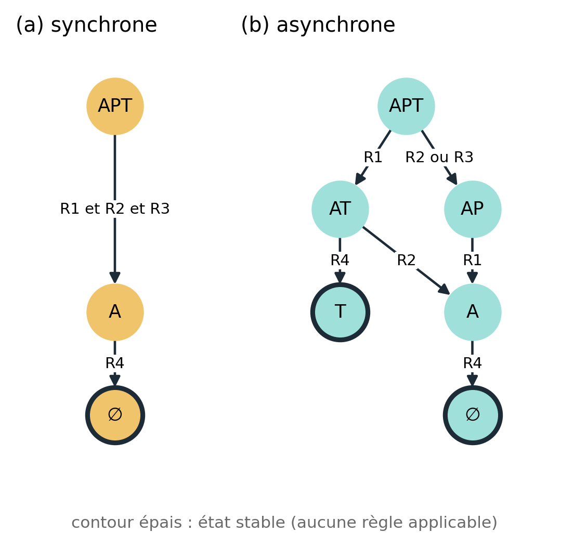

# Modèle qualitatif APT : synchrone ou asynchrone ?

Reproduction des **figures 5 et 7** de l'article de Cosme, Thomas et Gaucherel (2023) avec l'outil [`ecco`](https://codeberg.org/fpom/ecco) (cadre EDEN).

Projet de M2 Informatique, Université Paris-Saclay, réalisé par **Mohammed El Amine BENBAKRETI** et **Mohamed Aziz BEN ROMDHANE**.

> M. Cosme, C. Thomas, C. Gaucherel (2023). *On the History of Ecosystem Dynamical Modeling: The Rise and Promises of Qualitative Models.* Entropy 25(11), 1526. doi:[10.3390/e25111526](https://doi.org/10.3390/e25111526)

## L'idée en bref

Les modèles d'écosystèmes classiques reposent sur des équations dont les paramètres sont difficiles à mesurer. Les modèles **qualitatifs** s'en passent : chaque espèce est seulement présente (`+`) ou absente (`-`), et des règles décrivent ce qui peut arriver. L'article défend une exécution **asynchrone** de ces règles, une à la fois et dans n'importe quel ordre, plutôt que **synchrone**, où toutes les règles s'appliquent en même temps.

Le modèle APT compte trois protistes, l'amibe **A**, la paramécie **P** et *Tetrahymena* **T**, et quatre règles :

| Règle | Écriture `ecco` | Sens |
|---|---|---|
| R1 | `A+ >> P-` | A mange P |
| R2 | `A+ >> T-` | A mange T |
| R3 | `P+ >> T-` | P élimine T (compétition) |
| R4 | `P- >> A-` | sans P, A disparaît |

## Résultats

| Mode | États | Transitions | États stables | Trajectoires |
|---|---|---|---|---|
| Synchrone (Fig. 7a) | 3 | 2 | ∅ | 1 |
| Asynchrone (Fig. 5c, 7b) | 6 | 6 | {T} et ∅ | 3 |

- **Asynchrone.** Le graphe calculé par `ecco` est identique, arc par arc, à la figure 5c de l'article. T survit si A mange P (R1) puis disparaît faute de P (R4) **avant** d'avoir mangé T (R2). L'extinction de P est donc nécessaire mais pas suffisante pour aboutir à {T}.
- **Synchrone.** A mange P et T au même instant : la seule fin possible est ∅. Or {T} est observé expérimentalement (Weatherby *et al.*, 1998).
- **Limite.** `ecco` n'a pas de mode synchrone. Nous l'avons simulé en regroupant les règles à la main (`APT_synchrone.rr`, règles S1 et S2). Ce codage n'est valable que depuis l'état {APT}.

La reproduction valide le **calcul**, pas la conclusion **écologique** : celle-ci repose sur une seule étude expérimentale et un exemple de trois espèces. Le détail est dans le [rapport](rapport/rapport.pdf).

## Contenu du dépôt

| Dossier | Contenu |
|---|---|
| [`notebook/`](notebook/) | nos deux notebooks exécutés dans `ecco` Jupyter, [asynchrone](notebook/APT_asynchrone%20(1).ipynb) et [synchrone](notebook/APT_synchrone%20(1).ipynb), avec leurs fichiers `.rr` |
| [`modeles/`](modeles/) | `APT.rr` : modèle de la figure 5 ; `APT_synchrone.rr` : synchrone simulé à la main (règles S1 et S2) |
| [`figures/`](figures/) | `figure5_APT` et `figure7_sync_async` : figures du rapport et de la présentation (mêmes graphes que ceux affichés par `ecco`, avec le nom des états) ; `ecco_*.png` : captures des graphes dans `ecco` |
| [`rapport/`](rapport/) | [`rapport.pdf`](rapport/rapport.pdf) (page de garde et 3 pages) et sa source LaTeX |
| [`presentation/`](presentation/) | `presentation_APT.pptx` (8 minutes, avec notes de l'orateur) et `plan_presentation.md` (plan minuté et questions probables du jury) |
| [`article/`](article/) | l'article étudié (Entropy, licence CC BY 4.0) |

## Exécuter les notebooks

`ecco` ne fonctionne que sous Linux. On peut l'utiliser depuis le JupyterHub du cours ou avec l'image Docker `franckpommereau/ecco`.

1. Ouvrir les notebooks depuis `notebook/` : chaque notebook doit être dans le même dossier que son fichier `.rr`.
2. Lancer *Kernel → Restart & Run All*.
3. `draw()` affiche le graphe ; les onglets *Nodes* et *Edges* donnent les états et les règles de chaque arc.

`ecco` numérote les états : ▶ marque l'état initial et ■ un état stable.

- Asynchrone : 6 = APT, 5 = AT, 3 = AP, 2 = A, 4 = {T}, 1 = ∅.
- Synchrone : 3 = APT, 2 = A, 1 = ∅.

Compiler le rapport : `cd rapport && pdflatex rapport.tex`.
